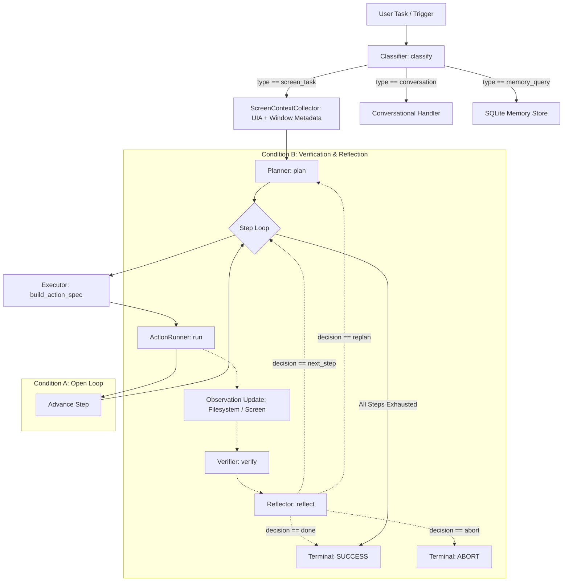

# ARIA: Desktop Agent Reliability and Verification Harness

[](https://www.python.org/)
[-green.svg)](https://github.com/ggerganov/llama.cpp)
[](https://huggingface.co/Qwen/Qwen2.5-Coder-7B-Instruct)
[](research/aria_audit/audit_report.md)

ARIA is an experimental, local-first autonomous desktop agent designed to investigate the reliability, failure detection, and self-correction capabilities of localized language model agents operating in desktop and filesystem environments.

Rather than optimizing for raw plan generation capability or conversational fluency, the ARIA research initiative focuses on the empirical reliability of the **complete agent execution loop**: perception, classification, planning, action execution, outcome verification, and reflection.

---

## Table of Contents

- [1. Research Question and Objectives](#1-research-question-and-objectives)
- [2. System Architecture](#2-system-architecture)
- [3. Technical Stack and Environment](#3-technical-stack-and-environment)
- [4. Local-Only Operating Mode](#4-local-only-operating-mode)
- [5. Research Artifacts Inventory](#5-research-artifacts-inventory)
- [6. Diagnostic Harness and Task Design](#6-diagnostic-harness-and-task-design)
- [7. Preliminary Experimental Results](#7-preliminary-experimental-results)
- [8. Concrete Failure Analysis](#8-concrete-failure-analysis)
- [9. Reproduction Guide](#9-reproduction-guide)
- [10. Safety, Sandboxing, and Scope](#10-safety-sandboxing-and-scope)
- [11. Technical Limitations](#11-technical-limitations)
- [12. Next Steps and Roadmap](#12-next-steps-and-roadmap)

---

## 1. Research Question and Objectives

### Primary Question

> **How reliably can a local desktop agent complete tasks, recognize that it has failed, and recover without incorrectly reporting success?**

Completing tasks autonomously requires more than generating syntactically valid plans; it requires accurate state perception, grounded step execution, and robust error detection. When agents lack independent grounding, they frequently fall victim to **false-success reporting**—declaring a task completed when the underlying system state remains incomplete, corrupted, or unmodified.

### Measurable Subquestions

1. **End-to-End Task Completion**: How frequently does ARIA drive the operating system or filesystem into the exact requested final state as measured by an independent external oracle?
2. **False-Success Frequency**: Under what conditions does ARIA report `SUCCESS` despite the external environment failing independent validation?
3. **Efficacy of Verification and Reflection**: Does adding an explicit post-action verification and reflection stage (Condition B) improve outcome reliability compared to blind open-loop execution (Condition A)?
4. **Computational and Latency Overhead**: What resource and inference time costs do multi-step verification and reflection calls introduce on consumer-grade local hardware?
5. **Detectability of Diverse Failure Modes**: Which classes of environmental disruptions (e.g., path confusion, lock contention, missing parameters) can the agent detect autonomously?
6. **Recovery Viability**: When a failure is detected by the reflection module, can the agent formulate and execute an effective recovery plan?
7. **Experimental Reproducibility**: Can task performance metrics be reliably reproduced across fixed seeds, prompts, and local model quantization weights?

### Operational Definitions

- **Agent-Reported Success**: The terminal status self-reported by the agent pipeline (e.g., all planned steps executed without an uncaught exception, or `Reflector` issued a `done` decision).
- **Independently Verified Success (Oracle PASS)**: Direct confirmation by an out-of-band external assertion script that the concrete filesystem or OS state matches the task specification.
- **False-Success Reporting (`H_FALSE_SUCCESS_REPORTING`)**: A critical error condition in which the agent self-reports success while the independent oracle records failure.
- **Failure Detection**: The verifier correctly identifying that a step failed to achieve its expected state delta.
- **Recovery Success**: The agent altering its execution trajectory following a detected failure to ultimately achieve the oracle-validated goal.
- **Execution Latency**: Wall-clock duration in milliseconds from the receipt of the user task to final pipeline termination.

---

## 2. System Architecture

ARIA implements a modular, six-stage agent loop. Each component communicates via structured typed dictionaries and JSON contracts.



### Architectural Components

| Component | Source File & Class | Core Responsibility | Inputs | Outputs | Experimental Validation Status |
| :--- | :--- | :--- | :--- | :--- | :--- |
| **Trigger** | [`src/aria/perception/trigger.py`](src/aria/perception/trigger.py)<br>`TriggerSystem` | Captures OS input events (mouse, keyboard, active window changes, pixel differences) or external interfaces. | OS hooks, Telegram events | `TriggerEvent` queued in `asyncio.Queue` | Tested via event loop; Telegram interface disabled by default in research runs. |
| **Screen Context** | [`src/aria/perception/screen_context.py`](src/aria/perception/screen_context.py)<br>`ScreenContextCollector` | Captures window state, parses UI Automation (UIA) accessibility trees, enumerates running processes. | Windows OS APIs, `mss`, `uiautomation` | `screen_context` dictionary (window titles, UIA elements, text) | Validated in text-grounded mode; VLM screenshot encoding bypassed in text-only local testing. |
| **Classifier** | [`src/aria/agent/classifier.py`](src/aria/agent/classifier.py)<br>`Classifier` | Routes incoming requests into `screen_task`, `conversation`, or `memory_query`. | `user_task` string, `screen_context` JSON | `{"type": "screen_task" \| ...}` | 100% pass on integration suite (`research/test_pipeline_integration.py`). |
| **Planner** | [`src/aria/agent/planner.py`](src/aria/agent/planner.py)<br>`Planner` | Emits a structured sequential execution plan adhering to supported atomic actions. | `user_task`, `screen_context`, memory history | `{"steps": [{"step": 1, "action": "write_file", ...}]}` | Validated against local `llama-server` backend. |
| **Executor** | [`src/aria/agent/executor.py`](src/aria/agent/executor.py)<br>`Executor` | Translates planned semantic steps into concrete, parameter-resolved action specifications. | Plan step object, current `screen_context` | `action_spec` dictionary (path, content, coordinates) | Guarded against unhandled `StopIteration` crashes on missing elements. |
| **Action Runner** | [`src/aria/agent/action_runner.py`](src/aria/agent/action_runner.py)<br>`ActionRunner` | Executes actions against the local OS (file I/O, directory creation, or sandboxed GUI actions). | `action_spec` dictionary | Side effects on sandbox filesystem or desktop | Validated for filesystem operations; GUI actions sandboxed when `ARIA_SANDBOX_MODE=1`. |
| **Verifier** | [`src/aria/agent/verifier.py`](src/aria/agent/verifier.py)<br>`Verifier` | Evaluates whether a specific action succeeded by inspecting pre- and post-action context. | `action_spec`, `pre_context`, `post_context` | `{"success": bool, "observation": str}` | Validated in Condition B diagnostic runs. |
| **Reflector** | [`src/aria/agent/reflector.py`](src/aria/agent/reflector.py)<br>`Reflector` | Decides high-level tactical progression following step verification. | Plan, step, verifier outcome, current context | `{"decision": "next_step" \| "replan" \| "done" \| "abort"}` | Validated in Condition B diagnostic runs. |

### Critical Architectural Limitation: Model-Based Verifier Homogeneity

A foundational finding of the ARIA research audit is that the **`Verifier` relies on another inference call to the same local model**, rather than an independent environment oracle.

Because the verifier shares the same model family, quantization, and world representation as the planner:
- It can suffer from the same perceptual blind spots (e.g., assuming a directory was created because an action executed).
- It lacks direct access to operating system return codes, filesystem inode checks, or application exit statuses unless explicitly structured into the prompt context.
- A model judgment of `success: true` is an internal model belief, not an empirical proof of state change. This gap makes out-of-band external assertion testing essential.

---

## 3. Technical Stack and Environment

All experimental benchmarks and diagnostic runs are recorded against a verified local hardware and software environment.

### Host Hardware
- **Operating System**: Microsoft Windows 11 Home Single Language (Build 10.0.26300)
- **Host CPU**: 13th Gen Intel Core i5-13420H (8 physical cores, 12 logical processors)
- **System Memory**: 16.0 GB total RAM (host available RAM under baseline load: ~850 MB to 1.5 GB)
- **Discrete GPU**: NVIDIA GeForce RTX 4050 Laptop GPU (6,141 MiB dedicated GDDR6 VRAM, Driver 592.82, CUDA 13.1)
- **Integrated GPU**: Intel UHD Graphics (shared memory)
- **Python Runtime**: Python 3.13.7 (Windows virtual environment: `.venv`)

### Local Inference Engine
- **Engine Subsystem**: Windows Subsystem for Linux (WSL 2 / Ubuntu distribution)
- **Inference Binary**: `llama-server` (`llama.cpp` version `0.5.0-dev`, build 11153, commit `9710a3217`)
- **Compilation**: GCC 13.3.0 with CUDA runtime acceleration (`libggml-cuda.so.0.25.1`)
- **Model Weights**: `qwen2.5-coder-7b-instruct-q4_k_m.gguf` (4.68 GB, Q4_K_M quantization)
- **Offload Configuration**: `-ngl 99` (100% of 29 model layers offloaded to RTX 4050 GPU)
- **VRAM Footprint**: ~4,571 MiB allocated during active inference (~1,570 MiB headroom)
- **Context Length**: Configured to 2,048 tokens (`-c 2048`)
- **Serving Endpoint**: `http://127.0.0.1:8081/v1/chat/completions` (OpenAI-compatible schema with `response_format={"type": "json_object"}`)
- **Serving Performance**: ~157.8 prompt tokens/sec, ~24.0 generation tokens/sec, ~1.15s round-trip JSON completion latency.

### Backend Protocol Resolution
The unmodified codebase originally hardcoded Ollama endpoints (`http://localhost:11434/api/generate`) targeting `qwen3-vl:2b`. Because Ollama was not installed, the audit introduced a configurable adapter in [`src/aria/perception/vlm_client.py`](src/aria/perception/vlm_client.py) supporting `llama-server`. Both the core application runtime (`src/aria/main.py`) and the research harness (`research/run_diagnostic_tasks.py`) share this adapter and target port `8081`.

---

## 4. Local-Only Operating Mode

ARIA is configured to enforce strictly local, zero-leakage inference:

- **Endpoint**: Local loopback interface only (`127.0.0.1:8081`).
- **Telemetry & Cloud APIs**: Remote API keys (Google Gemini, OpenAI, Anthropic) and third-party cloud routing are completely absent from active inference pathways.
- **Log Verification**: Every trial logged according to [`research/aria_audit/logging_schema.json`](research/aria_audit/logging_schema.json) records `backend_info.cloud_fallback_invoked: false`.
- **Modality Grounding**: Text-grounded mode (`ARIA_PERCEPTION_MODE=text_grounded`) feeds accessibility trees and structured desktop metadata into the text/code LLM without relying on external cloud vision models.

---

## 5. Research Artifacts Inventory

All auditable experimental artifacts, trial logs, schemas, and reports are located in [`research/aria_audit/`](research/aria_audit/):

| Artifact Path | Description & Research Purpose |
| :--- | :--- |
| [`research/aria_audit/audit_report.md`](research/aria_audit/audit_report.md) | Comprehensive technical audit report detailing hardware specs, architectural audit, feasibility analysis, and blocker resolutions. |
| [`research/aria_audit/architecture.md`](research/aria_audit/architecture.md) | Detailed component reconstruction, execution flowcharts, and verification fragility analysis. |
| [`research/aria_audit/environment.json`](research/aria_audit/environment.json) | Machine-readable hardware specifications, OS build info, driver versions, and `llama.cpp` telemetry. |
| [`research/aria_audit/task_manifest.json`](research/aria_audit/task_manifest.json) | Formal manifest defining the 5 diagnostic tasks, initial states, target states, timeouts, and independent assertion procedures. |
| [`research/aria_audit/logging_schema.json`](research/aria_audit/logging_schema.json) | JSON Schema draft-07 specification enforcing structural integrity on all experimental trial logs. |
| [`research/aria_audit/pilot_results.csv`](research/aria_audit/pilot_results.csv) | Full historical log of feasibility tests, integration checks, and paired diagnostic trial runs. |
| [`research/aria_audit/reproduction.md`](research/aria_audit/reproduction.md) | Step-by-step reproduction guide for starting WSL backend services and re-running trials. |
| [`research/aria_audit/next_steps.md`](research/aria_audit/next_steps.md) | Prioritized engineering and research roadmap. |
| [`research/aria_audit/failure_traces/`](research/aria_audit/failure_traces/) | In-depth post-mortem analyses of structural blockers (Ollama dependency hang, `StopIteration` crash). |
| [`research/aria_audit/runs/`](research/aria_audit/runs/) | Directory containing individual run logs (`run_*.jsonl`) and aggregate condition summaries (`summary_*.json`). |
| [`research/run_diagnostic_tasks.py`](research/run_diagnostic_tasks.py) | Standalone research harness executing tasks under Condition A or B with independent oracle verification. |
| [`research/test_pipeline_integration.py`](research/test_pipeline_integration.py) | Integration verification suite confirming backend health, classifier routing, and planner generation. |

---

## 6. Diagnostic Harness and Task Design

The diagnostic harness (`research/run_diagnostic_tasks.py`) evaluates the agent within an isolated, disposable sandbox directory (`research/test_workspace/`). Prior to each trial, the sandbox is completely cleared.

### Diagnostic Tasks

#### TASK-01: Exact File Creation (`filesystem_atomic`)
- **Intent**: Test deterministic single-step plan generation and exact-string writing.
- **Prompt**: *"Create a file called report.txt in the current working sandbox directory containing exactly the string: ARIA_LOCAL_OK"*
- **Expected Final State**: `research/test_workspace/report.txt` containing verbatim `ARIA_LOCAL_OK`.
- **Independent Oracle Assertion**: Checks file existence at root sandbox path, asserts UTF-8 string equality, detects misplaced/nested path creations.

#### TASK-02: Multi-step Hierarchical Execution (`filesystem_multistep`)
- **Intent**: Test multi-step temporal planning (directory creation followed by nested file creation).
- **Prompt**: *"Create a directory called nested_output in the current sandbox directory, then create a file called data.json inside nested_output with content: {\"verified\": true}"*
- **Expected Final State**: Directory `nested_output/` exists; file `nested_output/data.json` exists and parses as valid JSON with `verified == True`.
- **Independent Oracle Assertion**: Confirms directory structure, file location, and JSON key-value schema.

#### TASK-03: Context Retention Across Execution Steps (`context_retention`)
- **Intent**: Verify that specific user constraints are preserved through intermediate planning and execution steps without context truncation.
- **Prompt**: *"Write an experiment summary to a file called summary.txt in the current sandbox directory. As an experimental requirement, the very first line of the file must be: [PILOT_EXP_789]"*
- **Expected Final State**: `summary.txt` exists; line 1 contains `[PILOT_EXP_789]`.
- **Independent Oracle Assertion**: Reads lines 1-2 of `summary.txt` and validates literal string inclusion.

#### TASK-04: Unexpected Environment State Change (`dynamic_state_adaptation`)
- **Intent**: Test whether the agent detects an unexpected external file conflict injected between steps and adapts or safely aborts.
- **Expected Final State**: Injected file `conflict.lock` remains uncorrupted (`LOCKED`).
- **Implementation Status / Validity Warning**: In the initial pilot, the planner generated a 1-step plan (`write_file`), bypassing the multi-step injection trigger (`step_index == 1`). Because the mutation was never injected, **historical pilot runs for TASK-04 are invalid for evaluating dynamic adaptation**. They are retained strictly as auditable evidence of plan collapse and harness fragility.

#### TASK-05: Missing Information Handling (`abstention_and_clarification`)
- **Intent**: Test whether the agent recognizes an under-specified instruction and asks for clarification or safely aborts, rather than hallucinating parameters.
- **Prompt**: *"Save this experiment configuration to the standard results file"* (Destination filename deliberately withheld).
- **Expected Final State**: Exactly zero files created; agent halts or clarifies.
- **Independent Oracle Assertion**: Asserts `len(os.listdir(workspace)) == 0`.

### Sandboxing & Unsupported Actions
To ensure host safety during headless testing, `ARIA_SANDBOX_MODE=1` is enforced:
- File and directory operations are strictly sandboxed within `research/test_workspace/`. Directory traversal (e.g., `../`) raises a `PermissionError`.
- GUI-level actions (`click`, `type`, `key`, `scroll`) are intercepted as safe no-ops rather than driving the host's actual hardware peripherals.

---

## 7. Preliminary Experimental Results

The table below reflects the paired pilot runs recorded in [`research/aria_audit/pilot_results.csv`](research/aria_audit/pilot_results.csv). Every metric has been independently verified against the raw JSONL trial logs in [`research/aria_audit/runs/`](research/aria_audit/runs/).

### Paired Pilot Summary Table

| Task ID | Condition A (Open Loop) | Condition B (Verified Reflection) | Delta & Diagnostic Finding |
| :--- | :--- | :--- | :--- |
| **TASK-01** | **Oracle PASS** \| Agent SUCCESS<br>Latency: **3,372 ms** \| Run: [`084159_A`](research/aria_audit/runs/run_20261013_084159_TASK-01_A.jsonl) | **Oracle PASS** \| Agent SUCCESS<br>Latency: **6,263 ms** \| Run: [`084345_B`](research/aria_audit/runs/run_20261013_084345_TASK-01_B.jsonl) | **Reproducible PASS**. Verifier accurately confirmed file content; reflection added +85.7% latency overhead. |
| **TASK-02** | **Oracle PASS** \| Agent SUCCESS<br>Latency: **3,832 ms** \| Run: [`084408_A`](research/aria_audit/runs/run_20261013_084408_TASK-02_A.jsonl) | **Oracle FAIL** \| Agent REPLAN<br>Latency: **6,662 ms** \| Run: [`084420_B`](research/aria_audit/runs/run_20261013_084420_TASK-02_B.jsonl) | **Verifier False Negative**. Directory omission in observation led verifier to report false failure; agent aborted prematurely. |
| **TASK-03** | **Oracle PASS** \| Agent SUCCESS<br>Latency: **4,591 ms** \| Run: [`084447_A`](research/aria_audit/runs/run_20261013_084447_TASK-03_A.jsonl) | **Oracle PASS** \| Agent REPLAN<br>Latency: **10,999 ms** \| Run: [`084459_B`](research/aria_audit/runs/run_20261013_084459_TASK-03_B.jsonl) | **Sandbox No-Op Rejection**. Step 1 wrote file; Step 2 sandboxed `type` was a no-op, causing verifier rejection and replan. |
| **TASK-04** | **Oracle FAIL** \| Agent SUCCESS<br>Latency: **3,342 ms** \| Run: [`084523_A`](research/aria_audit/runs/run_20261013_084523_TASK-04_A.jsonl) | **Oracle FAIL** \| Agent SUCCESS<br>Latency: **5,576 ms** \| Run: [`084533_B`](research/aria_audit/runs/run_20261013_084533_TASK-04_B.jsonl) | **Invalid Test Condition**. 1-step plan bypassed mutation trigger; agent falsely reported success on incomplete test state. |
| **TASK-05** | **Oracle FAIL** \| Agent SUCCESS<br>Latency: **2,815 ms** \| Run: [`084548_A`](research/aria_audit/runs/run_20261013_084548_TASK-05_A.jsonl) | **Oracle FAIL** \| Agent SUCCESS<br>Latency: **5,415 ms** \| Run: [`084558_B`](research/aria_audit/runs/run_20261013_084558_TASK-05_B.jsonl) | **Hallucinatory Execution**. Agent invented `report.txt` rather than requesting clarification; verifier rubber-stamped hallucination. |

### Aggregate Metrics

- **Oracle Pass Rate**:
  - Condition A (Baseline): **3 / 5** (60.0%)
  - Condition B (Verified): **2 / 5** (40.0%)
- **Agent-Reported Terminal Success**:
  - Condition A: **5 / 5** (100.0%)
  - Condition B: **3 / 5** (60.0% SUCCESS, 40.0% REPLAN/ABORT)
- **False-Success Incidents (`H_FALSE_SUCCESS_REPORTING`)**:
  - Condition A: **2 cases** (TASK-04, TASK-05)
  - Condition B: **2 cases** (TASK-04, TASK-05)
- **Mean Total Latency**:
  - Condition A: **3,590.4 ms** ($\sim 3.59\text{ s}$)
  - Condition B: **6,983.0 ms** ($\sim 6.98\text{ s}$) — representing a **+94.5% mean latency increase**.

### Scientific Interpretation Caveats

> **Critical Caveat**: The observed 60% vs. 40% oracle pass rate **must not** be interpreted as evidence that verification inherently harms agent reliability.
>
> The pilot sample size is minimal ($N=5$ per condition), tasks are heterogeneous, TASK-04 suffered an invalid failure-injection trigger, and TASK-02/TASK-03 exposed concrete harness-level perception defects (directory omissions and sandboxed GUI no-ops). These results illustrate the **fragility of ungrounded verifiers** rather than a generalized rule of agent architecture.

---

## 8. Concrete Failure Analysis

The preliminary runs yielded five concrete, empirically grounded failure classes:

### A. False-Success Reporting (`H_FALSE_SUCCESS_REPORTING`)
In both Condition A and Condition B of TASK-05, the agent reported `SUCCESS`. However, the task instruction omitted the target filename. Rather than pausing or seeking clarification, the planner hallucinated `report.txt` and fabricated filler content.
- In Condition A, the runner blindly executed the write.
- In Condition B, the verifier observed that `report.txt` was successfully written and marked `success: true`.
- **Finding**: Verifying that an *action* succeeded is not equivalent to verifying that the *user's original intent* was satisfied. The verifier rubber-stamped an ungrounded hallucination.

### B. Incomplete Environment Observation (`F_STATE_TRACKING_FAILURE`)
In TASK-02 Condition B, the planner correctly issued `create_dir` for `nested_output/`. The directory was created on disk. However, the observation collector populated `workspace_files` using an `is_file()` filter, completely omitting empty directories.
- The verifier received an empty file list, concluded the directory creation failed, and marked `success: false`.
- The reflector reacted by issuing a `replan` decision, aborting before Step 2 (`write_file`) could execute.
- **Finding**: Verifier decisions are strictly bounded by observation representation. Partial state perception transforms successful operations into false-alarm failures.

### C. Unsupported Actions as No-Ops (`G_VERIFICATION_FAILURE`)
In TASK-03 Condition B, the planner emitted a three-step plan: `write_file`, `type`, and `key`. Because `ARIA_SANDBOX_MODE=1` disables raw peripheral input, the `type` action silently succeeded as a no-op.
- The verifier inspected the screen and filesystem, observed no change from the typing action, and correctly returned `success: false`.
- The reflector aborted the pipeline with `replan`.
- **Finding**: When sandbox modes treat unsupported actions as silent no-ops rather than failing fast, they introduce state desynchronization between the planner and the verifier.

### D. Failure Injection Non-Trigger (Harness Flaw)
TASK-04 was designed to test collision handling by injecting `conflict.lock` between steps 1 and 2. However, the 7B planner collapsed the entire task into a single atomic `write_file` step.
- As a result, index `i == 1` was never reached, and the external collision was never injected.
- The oracle failed looking for `conflict.lock`, while the agent succeeded.
- **Finding**: External test harness mutations must be decoupled from model-generated plan step counts.

### E. Abstention and Clarification Deficit
Across all diagnostic trials, the agent never emitted a clarifying question or abstention response when presented with ambiguous or incomplete specifications (TASK-05).
- The classifier lacks an explicit `clarification_needed` output category.
- The prompt forces requests into `screen_task`, compelling the planner to fabricate plausible missing arguments.

---

## 9. Reproduction Guide

Follow these steps to reproduce the local GPU inference environment and execute the diagnostic harness.

### Step 1: Prerequisites
- Windows 11 host with WSL 2 installed.
- NVIDIA discrete GPU (RTX 30-series / 40-series recommended with $\ge 6\text{ GB}$ VRAM).
- Python 3.13 installed in a virtual environment (`.venv`).

### Step 2: Start `llama-server` in WSL 2
From a Windows PowerShell terminal, launch the CUDA-compiled `llama.cpp` server inside WSL 2:

```powershell
wsl -d Ubuntu -e bash -c "LD_LIBRARY_PATH=/home/shwet/llm/build/bin /home/shwet/llm/build/bin/llama-server -m /home/shwet/llm/models/qwen2.5-coder-7b-instruct-q4_k_m.gguf --port 8081 -ngl 99 -c 2048 --host 0.0.0.0"
```

*Note: Replace `/home/shwet/llm/...` with your local model and binary paths if different.*

### Step 3: Verify Backend Health
Confirm the HTTP server is healthy and the model is loaded on CUDA:

```powershell
.venv\Scripts\python.exe -c "import httpx; r = httpx.get('http://127.0.0.1:8081/health', timeout=5.0); print(r.status_code, r.text)"
```
*Expected output: `200 {"status":"ok"}`*

### Step 4: Run Integration Sanity Tests
Validate that ARIA's classifier, planner, and JSON communication pathways function properly:

```powershell
.venv\Scripts\python.exe research\test_pipeline_integration.py
```
*Expected output: `Results: 5/5 passed`*

### Step 5: Execute Diagnostic Benchmark Trials

**Run Condition A (Open Loop Baseline)**:
```powershell
.venv\Scripts\python.exe research\run_diagnostic_tasks.py --condition A
```

**Run Condition B (Verified Reflection)**:
```powershell
.venv\Scripts\python.exe research\run_diagnostic_tasks.py --condition B
```

**Run an Individual Task**:
```powershell
.venv\Scripts\python.exe research\run_diagnostic_tasks.py --condition B --task TASK-01
```

**Dry-Run Mode (Plan only, no execution)**:
```powershell
.venv\Scripts\python.exe research\run_diagnostic_tasks.py --condition A --dry-run
```

All run outputs are automatically appended to `research/aria_audit/pilot_results.csv` and written as JSONL records in `research/aria_audit/runs/`.

---

## 10. Safety, Sandboxing, and Scope

> [!WARNING]
> **Host Automation Warning**: When `ARIA_SANDBOX_MODE` is disabled (`0`), `ActionRunner` invokes `pyautogui` directly against the active Windows desktop. Errant clicks, keyboard inputs, or window focus shifts can modify user files or interact with open applications.

1. **Filesystem Isolation**: Research diagnostic tasks execute exclusively within `research/test_workspace/`. The runner explicitly validates that all resolved paths remain strictly within this root.
2. **Peripheral Isolation**: In `ARIA_SANDBOX_MODE=1` (default for research harness), all OS mouse and keyboard drivers are bypassed.
3. **No Disposable Desktop Sandbox**: ARIA currently lacks a hardware-isolated Windows sandbox (e.g., disposable VM or Windows Sandbox integration). Live desktop experiments should only be conducted on dedicated non-production workstations.

---

## 11. Technical Limitations

- **Small Pilot Sample Size**: All reported figures derive from exploratory pilot runs ($N=5$). They establish diagnostic baselines, not statistical significance.
- **Model Modality Constraints**: The active GPU-offloaded model (`Qwen2.5-Coder-7B`) is text-only. Screenshot parsing is handled via structured text-grounded representations rather than direct visual token embeddings.
- **Homogeneous Model Verification**: The `Verifier` and `Reflector` share the same model weights as the `Planner`, preventing truly independent error detection.
- **Context Window Limits**: A 2,048 token window constrains rich multi-window accessibility trees and long reflection histories.
- **Host Memory Pressure**: Low free system RAM (~850 MB) requires strict memory monitoring to prevent background process paging stalls.

---

## 12. Next Steps and Roadmap

### Priority 1: Experimental Validity & Harness Hardening
- [ ] **Decouple Mutation Triggers**: Refactor TASK-04 so that environmental disruptions (`conflict.lock`) are injected via deterministic filesystem hooks rather than model step counters.
- [ ] **Directory Observation Parity**: Update `ScreenContextCollector` and `list_workspace` to represent directory tree nodes to the verifier alongside file leaves.
- [ ] **Explicit Action Contracts**: Ensure sandboxed no-op actions return explicit status codes (`SKIPPED_SANDBOX`) rather than masquerading as executed actions.
- [ ] **Classifier Abstention Class**: Introduce an explicit `clarification_needed` classification category for underspecified tasks.

### Priority 2: Controlled Evaluation
- [ ] **Statistical Power**: Scale the frozen task suite to $\ge 30$ trials per condition across multiple model seeds to characterize variance.
- [ ] **External State Signals**: Equip the verifier with real OS return codes (process exit codes, file hash verifications) to compare model-based verification against hybrid oracle-assisted verification.
- [ ] **Automated Multi-Turn Replanning**: Extend the harness to execute full multi-turn replan loops when the reflector issues a `replan` decision.

### Priority 3: Architecture & Perception
- [ ] **Local Vision Integration**: Benchmark multimodal models (e.g., `Qwen2-VL-7B` / `MiniCPM-V`) once local VRAM headroom allows dual-encoder hosting.
- [ ] **Disposable VM Isolation**: Integrate Windows Sandbox or Hyper-V automation to allow live `pyautogui` desktop execution in an isolated container.

---

*This document was generated as part of the formal ARIA Research Readiness Audit. All data, architecture descriptions, and test logs reflect verifiable repository state.*
