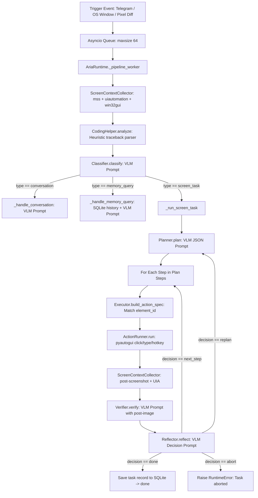

# ARIA Architecture Analysis & Pipeline Reconstruction

## 1. Executive Pipeline Flow

---

## 2. Component-by-Component Reconstruction

| Component | File & Class/Function | Current Implementation | Functional Status | Evidence / Notes |
| :--- | :--- | :--- | :--- | :--- |
| **1. Task Input** | `src/aria/perception/trigger.py` (`TriggerSystem`), `src/aria/interface/telegram_bot.py` | Receives messages via Telegram bot or internal triggers (mouse click, keyboard, window change, pixel diff). Pushes into `asyncio.Queue(maxsize=64)`. | **Functional (Partially)** | Tested queue and trigger data structures. Telegram requires valid bot token; disabled by default via `ARIA_DISABLE_TELEGRAM=1`. |
| **2. Prompt Construction** | `src/aria/agent/planner.py`, `verifier.py`, `reflector.py`, `classifier.py` | In-line string formatting with embedded JSON structures (`json.dumps`). Prompts enforce JSON outputs. | **Incomplete / Fragile** | Hardcoded prompts lack system instructions, few-shot grounding, or schema validation schemas. |
| **3. Inference Provider** | `src/aria/perception/vlm_client.py` (`VLMClient`) | Sends HTTP POST requests directly to `http://localhost:11434/api/generate`. | **Non-Functional** | Hardcodes Ollama REST API. Ollama is not installed or running. Does not support `llama-server` / OpenAI endpoints. |
| **4. Model & Version** | `src/aria/config.py` (`VLM_MODEL`) | Defaults to `qwen3-vl:2b`. | **Missing / Mismatched** | `qwen3-vl:2b` is not present. Available model is `qwen2.5-coder-7b-instruct-q4_k_m.gguf` under `llama.cpp` in WSL. |
| **5. Generation Settings** | `src/aria/perception/vlm_client.py` | `temperature: 0.0`, `num_predict: 384`, `num_ctx: 1024`, `format: json`. | **Functional in code, but constrained** | `num_ctx` of 1024 is extremely small for rich desktop UIA JSON context. |
| **6. Perception & Vision** | `src/aria/perception/screen_context.py` (`ScreenContextCollector`) | Captures screen via `mss`, parses UIA controls with `uiautomation`, queries active processes with `psutil`/`win32gui`, queries VLM. | **Partially Functional** | Local UIA and screenshot capture work; VLM perception fails due to unreachable port 11434. |
| **7. Desktop Execution** | `src/aria/agent/action_runner.py` (`ActionRunner`) | Calls `pyautogui.click()`, `pyautogui.typewrite()`, `pyautogui.hotkey()`, `pyautogui.scroll()`. | **Unsafe / Unconstrained** | Executes directly on user desktop without containerization, dry-run, or coordinate bounds checks. |
| **8. Action Validation** | `src/aria/agent/executor.py` (`Executor`) | Resolves `element_id` against `screen_context["interactable_elements"]`. | **Defective** | Uses `next(...)` without default. If `element_id` is missing or invalid, raises uncaught `StopIteration`. |
| **9. Context Persistence** | `src/aria/memory/sqlite_store.py` (`SQLiteStore`) | Stores snapshots, interactions, task plans, and daily goals in SQLite WAL database `aria_memory.db`. | **Functional** | SQLite schema verified (`aria_memory.db` exists in workspace root). |
| **10. Planning** | `src/aria/agent/planner.py` (`Planner`) | Generates multi-step plan array (`{"steps": [...]}`). | **Untested with local model** | Code exists, but blocked by backend connection failure. |
| **11. State Tracking** | `src/aria/main.py` (`_run_screen_task`) | Tracks `current_context` and captures post-action screenshot and UIA tree. | **Functional structure** | State delta captured between each step loop iteration. |
| **12. Verification & Reflection**| `src/aria/agent/verifier.py`, `src/aria/agent/reflector.py` | Verifier inspects action + pre/post context + post screenshot. Reflector decides `next_step`, `replan`, `done`, or `abort`. | **Untested with local model** | Complete structural implementation present in code; blocked by inference connection. |
| **13. Retry & Recovery** | `src/aria/main.py` (lines 234-246) | When reflector returns `replan`, prompts planner for new plan and saves status. When `abort`, raises `RuntimeError`. | **Incomplete** | Replan triggers only once in the loop and immediately returns `"Replanned due to screen changes"` rather than executing the new plan. |
| **14. Reporting** | `src/aria/main.py` | Returns string status to caller / voice synthesizer (`Edge-TTS` + `playsound`). | **Partially Functional** | `playsound` is installed in venv, but audio synthesis can block headless environments. |
| **15. Cloud Fallback** | Repository wide | None in current `src/aria`. | **Local-Only Confirmed** | No cloud fallback mechanism exists in `src/aria/`. Previous cloud components from `screensense` were deleted. |
| **16. Error Handling** | `src/aria/main.py` | Minimal try/catch; uncaught exceptions crash the worker loop. | **Incomplete** | Unhandled `httpx.ConnectError` or `StopIteration` halts execution. |
| **17. Timeouts** | `vlm_client.py` | `ARIA_VLM_TIMEOUT_SECONDS=180`. | **Functional** | Configurable via environment variable. |

---

## 3. Critical Verification Analysis

### Can the agent generate actions when required context or observations are absent?
1. **Missing observations representation**: If the VLM call fails, `ScreenContextCollector` raises an exception; it does **not** generate mock or empty observations to proceed. However, if UIA elements are empty (`[]`), the planner still attempts to plan based on string prompts.
2. **Context indication**: The model receives raw JSON. If elements are empty, `interactable_elements: []` is passed.
3. **Invalid action handling**: Unsupported action strings raise `ValueError(f"Unsupported action: {action}")`. However, invalid `element_id` integers crash the executor via unhandled `StopIteration`.
4. **Abstention & Clarification**: The Classifier has only 3 discrete types: `screen_task`, `conversation`, `memory_query`. It does not have an explicit `abstain` or `clarification` state. If ambiguous, the agent forces the prompt into one of these three paths.
5. **Independent verification vs Model claim**: In ARIA, "verification" is simply another prompt to the same VLM (`Verifier.verify`). There is **zero external oracle or environment verification**. If the model hallucinates success, the pipeline accepts it without verification against filesystem or OS state.
